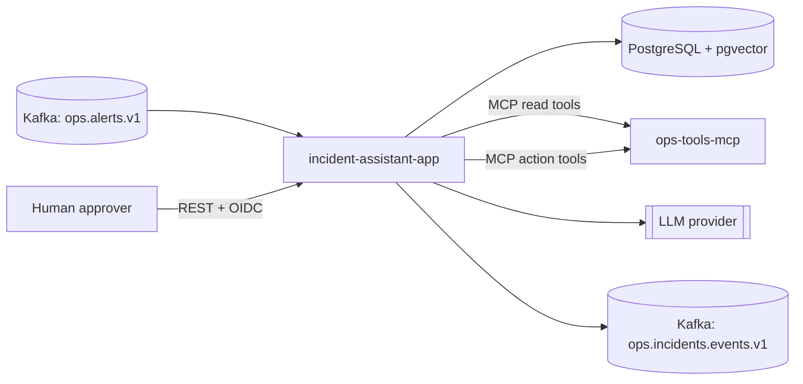
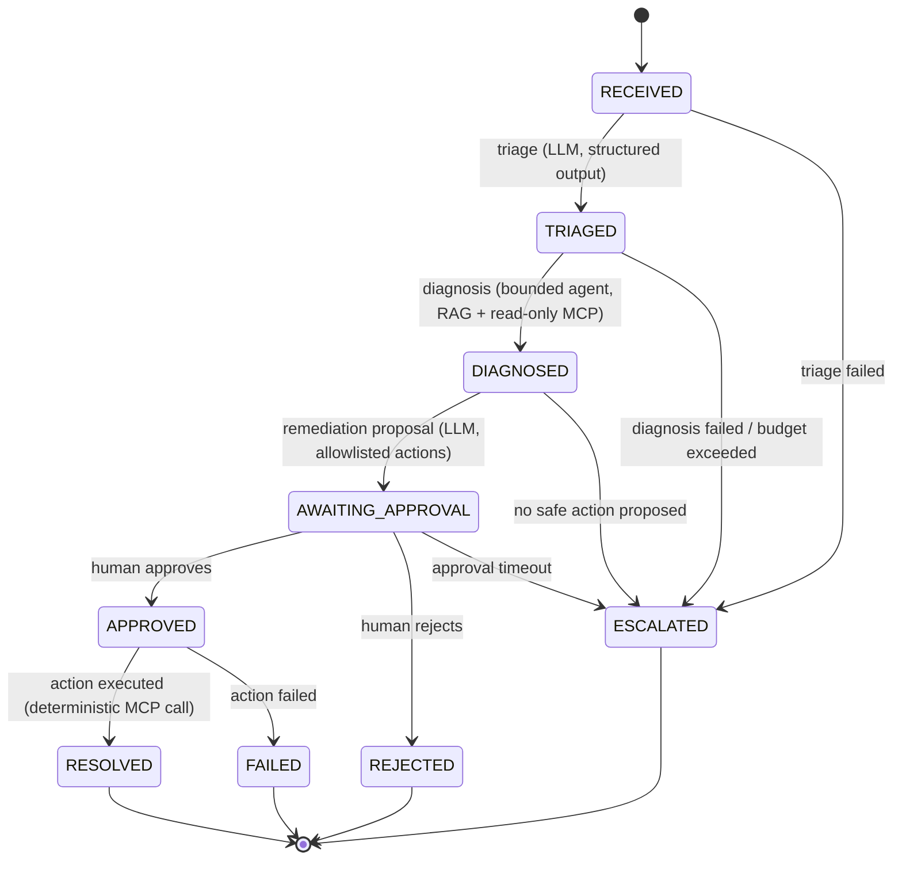

# Architecture overview

## Context

## Workflow (hybrid)

Explicit, persisted state machine. Only the diagnosis step is autonomous, and only with
read-only tools and a step budget (A-0001, P-0006).

| Step | Kind | LLM | Tools | Output |
|---|---|---|---|---|
| Triage | explicit | yes | none | severity, category, affected service |
| Diagnosis | **autonomous, bounded** | yes | RAG + read-only MCP | hypothesis, evidence, confidence |
| Proposal | explicit | yes | none | one action from allowlist + rationale |
| Approval | explicit | no | — | human decision |
| Execution | explicit | **no** | action MCP tool | result |

## Key principles

- Autonomy proportional to reversibility: reading is autonomous, writing requires approval.
- The LLM never calls a write tool. Execution is plain code calling MCP.
- All alert content and retrieved documents are untrusted input to the LLM.
- Every state transition is persisted, published as an event, and traceable to the
  prompt version and model that produced it.
